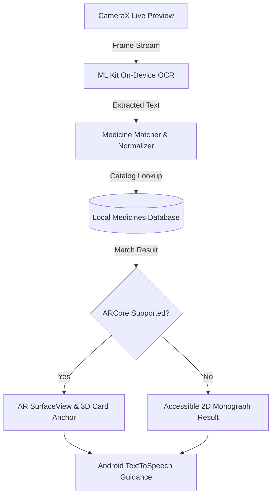

# AR-Based Medicine Identifier 💊👁️

[](https://developer.android.com/)
[](https://kotlinlang.org/)
[](https://developer.android.com/jetpack/compose)
[](https://developers.google.com/ml-kit)
[](https://developers.google.com/ar)
[](LICENSE)

An accessible, on-device Android application that combines **Optical Character Recognition (OCR)**, **Augmented Reality (AR)**, and **Text-to-Speech (TTS)** to identify prescription and over-the-counter medicines from physical packaging and blister packs in real time.

Designed specifically with accessibility in mind, the app empowers visually impaired individuals and elderly patients to independently verify medicine names, active ingredients, dosage directions, critical warnings, and side effects without requiring internet connectivity.

---

## 🌟 Key Features

- 📷 **Live Camera Capture & OCR**: Powered by Google ML Kit (on-device) to extract text from medicine boxes, strips, and labels in real time.
- 🔍 **Offline Intelligent Matching**: Normalizes and matches recognized text against a curated local pharmaceutical monograph catalog (`medicines.json`).
- 👓 **Anchored AR Card Overlay**: Spawns an interactive 3D augmented reality information card directly over the recognized medicine package using Google ARCore.
- 🛡️ **Graceful 2D Fallback**: Automatically detects device capabilities; if ARCore is unavailable (or unsupported on hardware like Exynos chipsets), the app seamlessly falls back to high-contrast 2D structured monographs.
- 🗣️ **Accessible Voice Guidance & TTS**:
  - **Single Tap**: Scans the package, speaks the medicine name and dosage, and renders the AR overlay.
  - **Double Tap**: Plays audio readout of warnings, contraindications, and potential side effects.
  - **Long Press**: Delivers complete clinical profile audio summary.
  - **Touch Movement Filter**: Filters out hand tremors and panning motions ($> 20\text{px}$) to avoid accidental triggers.
- 🔒 **100% On-Device & Privacy Preserving**: Zero network requests or cloud dependencies. Patient data and camera feeds remain strictly local on the device.

---

## 🏗️ System Architecture



---

## 🛠️ Tech Stack & Dependencies

| Layer | Technology |
|---|---|
| **Language & Tooling** | Kotlin 2.0+, Java 21, Gradle 8.11 |
| **UI Framework** | Jetpack Compose & Material 3 |
| **Camera Pipeline** | AndroidX CameraX (Core, Camera2, Lifecycle, View) |
| **Text Recognition** | Google ML Kit Text Recognition (`com.google.android.gms:play-services-mlkit-text-recognition`) |
| **Augmented Reality** | Google ARCore SDK (`com.google.ar:core`) |
| **Serialization** | Kotlinx Serialization JSON |
| **Audio Guidance** | Native Android `TextToSpeech` Engine |
| **Testing** | JUnit 4, AndroidX Test, Compose UI Test |

---

## 📁 Repository Structure

```text
AR-Medicine-Identifier/
├── app/
│   ├── src/
│   │   ├── main/
│   │   │   ├── assets/
│   │   │   │   └── medicines.json          # Curated offline medicine database
│   │   │   ├── java/com/armod/identifier/
│   │   │   │   ├── ar/                     # ARCore session & surface handling
│   │   │   │   ├── camera/                 # CameraX preview and capture management
│   │   │   │   ├── data/                   # JSON parser, repositories, & models
│   │   │   │   ├── domain/                 # State management & identification logic
│   │   │   │   ├── matching/               # Fuzzy and exact medicine name matching
│   │   │   │   ├── ocr/                    # ML Kit text recognition processor
│   │   │   │   ├── tts/                    # Text-to-Speech manager & speech generators
│   │   │   │   ├── ui/                     # Jetpack Compose screens, themes, gestures
│   │   │   │   └── util/                   # Text normalization helpers
│   │   │   └── AndroidManifest.xml
│   │   └── test/                           # 79+ Unit & Edge-Case test suites
│   ├── build.gradle.kts
│   └── proguard-rules.pro
├── gradle/
│   └── libs.versions.toml                  # Version catalog
├── build.gradle.kts
├── settings.gradle.kts
└── README.md
```

---

## 🚀 Getting Started

### Prerequisites

- **Android Studio**: Ladybug (2024.2.1+) or newer
- **JDK**: Java Development Kit 21
- **Android SDK**: API Level 35 (compile & target), Minimum SDK API 26 (Android 8.0 Oreo)
- **Target Device / Emulator**: 
  - Physical Android device with camera hardware recommended
  - ARCore-compatible device recommended for 3D AR mode (app includes automatic 2D fallback for non-ARCore devices)

### Building the Project

1. **Clone the repository:**
   ```bash
   git clone https://github.com/SpurthiRKatoker/AR-Based-Medicine-Identifier.git
   cd AR-Based-Medicine-Identifier
   ```

2. **Run Unit Tests:**
   ```bash
   # Windows
   .\gradlew.bat test

   # Linux / macOS
   ./gradlew test
   ```

3. **Assemble Debug APK:**
   ```bash
   # Windows
   .\gradlew.bat assembleDebug

   # Linux / macOS
   ./gradlew assembleDebug
   ```
   The built APK will be located at:
   `app/build/outputs/apk/debug/app-debug.apk`

4. **Install onto connected device via ADB:**
   ```bash
   adb install -r app/build/outputs/apk/debug/app-debug.apk
   ```

---

## 📱 User Journey & Gestures

1. **Welcome & Safety Notice**: Launch screen introducing the tool with clear accessibility disclaimers.
2. **Camera Framing Guidance**: Visual guides with contrasting borders instructing optimal distance and angle.
3. **Live Camera Screen**:
   - **Single Tap**: Scans the medicine strip/box, performs OCR, matches against database, speaks the identified medicine, and displays the AR card over the target.
   - **Double Tap**: Immediately announces warnings and side effects.
   - **Long Press**: Plays complete clinical summary.
   - **"READ INFORMATION" Button**: Opens the detailed full-screen monograph hub.
   - **"Scan Again" Control**: Clears overlays and resets the camera state.
4. **Structured Information Hub**: Accessible view detailing Brand, Generic Active Ingredient, Dosage Form, Manufacturer, Batch/Expiry detection, and Clinical Warnings with dedicated **Speak**, **Stop**, and **Repeat** voice controls.

---

## 🧪 Testing & Validation

The codebase includes an extensive automated test suite covering:
- **Baseline Unit Tests**: Data source loading and JSON schema validation.
- **OCR Pipeline**: Normalization, punctuation cleanup, and noise reduction.
- **Medicine Matcher**: Exact matches, fuzzy matches, brand aliases, and negative/unmatched scenarios.
- **Gesture State Machine**: Single tap, double tap, long press, and tremor/movement threshold rejection.
- **Edge Cases**: Empty text, unreadable labels, low lighting alerts, and fallback handling.

---

## ⚖️ Disclaimer

> [!IMPORTANT]
> This application is an **academic project and assistive prototype**. It is intended to aid recognition and provide information assistance. It should not be used as a substitute for professional medical advice, diagnosis, or clinical consultation. Always verify medication details with a qualified healthcare provider or pharmacist.
